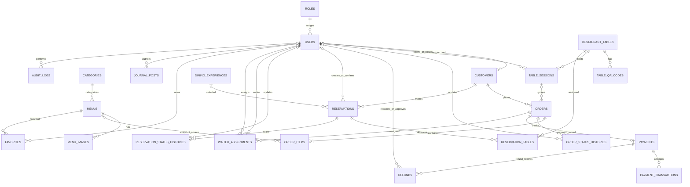

# NUSARA — Entity Relationship Diagram (ERD)

**Sumber:** NUSARA PRD & ERD Final Draft v3.0.

## 1. Entitas dan atribut utama

| Entitas | Atribut kunci |
|---|---|
| `roles` | id PK, name UNIQUE, description |
| `users` | id PK, role_id FK, name, email UNIQUE, password, is_active |
| `customers` | id PK, user_id FK nullable UNIQUE, name, phone_normalized UNIQUE, email nullable, phone_verified_at |
| `categories` | id PK, name, slug UNIQUE, description, is_active |
| `menus` | id PK, category_id FK, name, slug UNIQUE, description, price, stock_quantity, is_available, is_featured, deleted_at |
| `menu_images` | id PK, menu_id FK, image_path, is_primary |
| `restaurant_tables` | id PK, table_number UNIQUE, capacity, location, status, is_active |
| `table_qr_codes` | id PK, table_id FK, token_hash UNIQUE, is_active |
| `table_sessions` | id PK, table_id FK, session_code UNIQUE, status, opened_by FK nullable, closed_by FK nullable, started_at, ended_at |
| `orders` | id PK, order_code UNIQUE, access_token_hash, customer_id FK, table_session_id FK nullable, order_type, order_status, subtotal, tax, discount, total, customer_notes, pickup_time nullable |
| `order_items` | id PK, order_id FK, menu_id FK nullable, menu_name_snapshot, unit_price_snapshot, quantity, subtotal, item_notes |
| `order_status_histories` | id PK, order_id FK, changed_by FK nullable, previous_status, new_status, notes, created_at |
| `payments` | id PK, order_id FK, payment_method, payment_status, amount, paid_at |
| `payment_transactions` | id PK, payment_id FK, provider, provider_transaction_id, transaction_status, payment_url, expires_at, response_data JSON |
| `refunds` | id PK, payment_id FK, amount, reason, refund_method, refund_status, requested_by FK, approved_by FK nullable, provider_refund_id, processed_at |
| `reservations` | id PK, reservation_code UNIQUE, customer_id FK, experience_id FK nullable, reservation_datetime, guest_count, duration_minutes, status, special_request, source, created_by FK nullable, confirmed_by FK nullable |
| `reservation_tables` | id PK, reservation_id FK, table_id FK |
| `reservation_status_histories` | id PK, reservation_id FK, changed_by FK nullable, previous_status, new_status, notes |
| `waiter_assignments` | id PK, order_id FK, waiter_id FK users, assigned_by FK users nullable, assigned_at |
| `favorites` | id PK, user_id FK, menu_id FK, created_at, UNIQUE(user_id, menu_id) |
| `dining_experiences` | id PK, name, slug, description, duration_minutes, is_available |
| `operating_hours` | id PK, day_of_week, open_time, close_time, is_closed |
| `restaurant_settings` | id PK, restaurant_name, address, phone, email, social links, tax_percentage, reservation_policy |
| `contacts` | id PK, name, email, subject, message, status |
| `journal_posts` | id PK, title, slug, content, image, status, published_at, created_by FK |
| `audit_logs` | id PK, user_id FK nullable, action, entity_type, entity_id, description, created_at |

## 2. Diagram relasi

